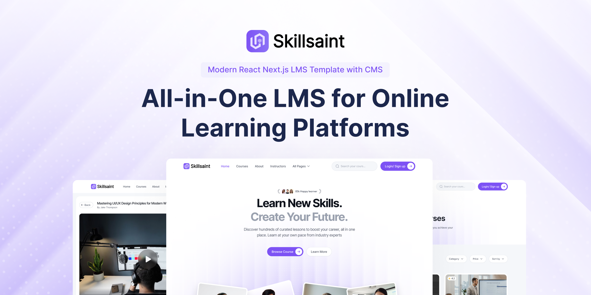

# Future Mariners - IMUCET Learning Platform

Future Mariners is a full-stack learning platform built with React, Next.js, Prisma, PostgreSQL, and Razorpay for IMUCET preparation courses.



#### [🚀 Visit Website](https://skillsaint.com)

#### [🚀 Live Demo](https://demo.skillsaint.com)

#### [🔥 Get Pro](https://skillsaint.com/pricing)

#### [🔌 Documentation](https://skillsaint.com/docs)

## Feature Highlights
This is a free, light, open-source version of Skillsaint to try out and use as a landing page. Skillsaint Pro includes all the features with fully functional LMS features mentioned below.

### **Modern Tech-Stack**
Built with React, Next.js, Tailwind CSS, and Sanity CMS for performance, SEO, and flexible content management.

### **Complete LMS Features with CMS**
Courses, lessons, user authentication, enrollment, dashboards, progress tracking, and certifications - everything needed to run a full LMS powered by Sanity CMS.

### **Integrated Payments**
Razorpay-powered checkout for paid courses. Secure payments, automatic enrollment, and controlled access to premium content.

### **Essential Integrations**
Sanity for content, Prisma for PostgreSQL, Razorpay for payments, Auth.js for authentication and many more - ready to use out of the box.

### **Scalable & Extendable**
Start with a solid boilerplate and extend as your platform grows. Clean architecture designed for customization.

### **Responsive & High-Quality UI**

Fully responsive learning interface and dashboard with clean layouts and intuitive navigation.

### **Lifetime Updates**

Free lifetime updates with ongoing improvements and enhancements.

**Detailed Documentation**

Step-by-step setup and customization guides to help you launch and scale efficiently.

## Backend setup

The application uses Auth.js, Prisma, PostgreSQL, and Razorpay Checkout.

1. Copy the required values from `.env.example` into `.env.local`:

	- `DATABASE_URL`: your Neon pooled PostgreSQL connection string
	- `DIRECT_URL`: your Neon direct PostgreSQL connection string for migrations
	- `AUTH_SECRET`: a long random secret
	- `GOOGLE_CLIENT_ID` and `GOOGLE_CLIENT_SECRET`: optional Google OAuth credentials
	- `RAZORPAY_KEY_ID`: your Razorpay key ID
	- `RAZORPAY_KEY_SECRET`: your Razorpay key secret
	- `NEXT_PUBLIC_RAZORPAY_KEY_ID`: your browser-safe Razorpay key ID (never put the secret here)
	- `RAZORPAY_WEBHOOK_SECRET`: the webhook secret configured for `/api/razorpay/webhook`

2. Apply the database migrations:

	```bash
	npm run db:migrate
	```

3. Create the local dashboard demo account:

	```bash
	npm run seed
	```

	Demo login: `demo@skillsaint.local` / `DemoPass123!`
	The seed creates a paid course with six sample lessons and 42% progress. It requires `DATABASE_URL` and `DIRECT_URL` to be configured, and the database migrations must be applied first.

4. Start the app:

	```bash
	npm run dev
	```

5. Configure a Razorpay webhook for the `payment.captured` event:

	```bash
	# Set the webhook URL to https://your-domain.example/api/razorpay/webhook
	```

Never commit `.env.local` or share secret keys in chat, screenshots, or source control.

## Production deployment

1. Set the variables in `.env.example` in your hosting provider. Use the production `NEXT_PUBLIC_BASE_URL` and `NEXTAUTH_URL`, a new `AUTH_SECRET`, the pooled `DATABASE_URL`, and the direct `DIRECT_URL`.
2. Deploy the application with the build command `npm run build` and start command `npm run start`.
3. Apply database migrations once per release or from a deployment job with:

	```bash
	npm run db:migrate:deploy
	```

4. Configure the Razorpay webhook URL as `https://your-domain.example/api/razorpay/webhook` and use the same `RAZORPAY_WEBHOOK_SECRET` in the hosting environment.

The app uses Next.js standalone output, so hosting providers that support Next.js can run the standard commands above. Do not run `npm run seed` in production; it is a local demo seed and is intentionally disabled when `NODE_ENV=production`.

## Neon and cloud video setup

The application uses **Neon Postgres as the hosted database** through Prisma. Auth.js stores student accounts and sessions against that database, while Razorpay controls payment state.

1. Create a Neon project and copy both connection strings from the Neon dashboard into `.env.local`:
	- `DATABASE_URL`: the pooled connection string. Its hostname contains `-pooler`.
	- `DIRECT_URL`: the direct connection string without `-pooler`, used for migrations.
   Keep the password URL-encoded.
2. Run the schema migration:

	```bash
	npx prisma migrate dev --name add-bunny-lessons
	```

3. Create a Bunny Stream video library. Put the library ID, API key, and optional token key in `.env.local`.
4. Add each recorded lesson to the `Lesson` table with:
	- `courseId`: the matching course record
	- `title`: the lesson title
	- `bunnyVideoId`: the Bunny video GUID
	- `bunnyLibraryId`: the library ID, if different from the default
	- `sortOrder`: the lesson position
5. Paid students can access `/learn/<course-slug>`. The server checks the `PAID` enrollment before returning lesson metadata and renders Bunny's embed player from the stored video ID.

Bunny's standard player URL is generated as `https://iframe.mediadelivery.net/embed/<library-id>/<video-id>`. Keep token keys and API keys server-side. For higher-value content, enable Bunny token authentication or MediaCage DRM in the Bunny dashboard; no client-side secret should be added to the browser.
